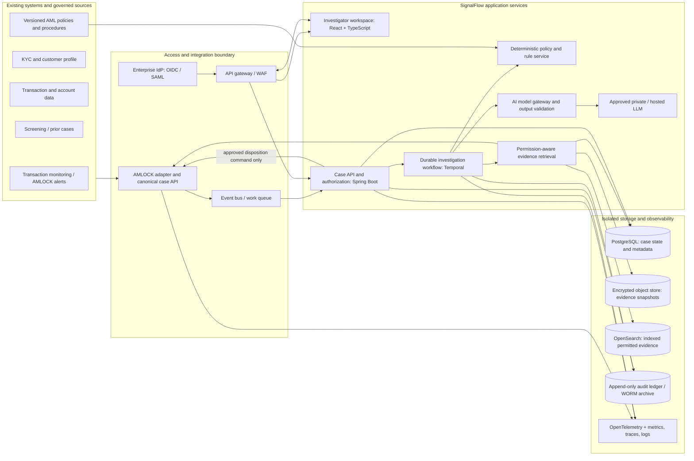

# SignalFlow: AML Investigation Copilot
## System Architecture and Technology Stack Proposal

**Purpose:** A production-oriented proposal for an evidence-grounded assistant that helps AML investigators move from transaction-monitoring alert to a documented next action while retaining human decision authority.

**Status and scope:** This is a solution proposal, not an official Azentio design or a claim that specific AMLOCK integration APIs are available. The existing SignalFlow website is a public hackathon prototype that uses fictional records. Production interfaces, deployment constraints, controls, and data residency must be confirmed with the product owner, security team, and AML domain experts before implementation.

## 1. Executive summary

SignalFlow should be implemented as an **investigation-support layer beside the existing monitoring and case-management platform**, not as a replacement for transaction monitoring and not as an autonomous disposition engine. It ingests an alert through an approved, versioned adapter; assembles only authorized case context; evaluates deterministic policy and risk rules; and optionally uses a governed language model to summarize already-retrieved evidence into a concise, cited recommendation. The investigator reviews the evidence, corrects or supplements context, and explicitly records the disposition in the authoritative case system.

The design separates four concerns that are often conflated in AI demos: **source-of-truth case data**, **deterministic controls and rules**, **probabilistic language-model assistance**, and **the human decision and audit record**. An LLM may explain or organize evidence; it does not create authoritative facts, override policy, close alerts, file reports, freeze funds, or make customer decisions.

## 2. Problem and design goals

AML teams need to investigate large alert volumes while preserving consistency, traceability, and defensible records. Relevant evidence may be spread across alert data, customer profiles, transaction histories, screening results, documents, and policies. A risk score alone does not tell an analyst why an alert fired, what corroborates it, what is missing, or what review step is appropriate.

The system should:

1. Reduce avoidable manual context gathering and repeated navigation.
2. Present an evidence-linked explanation for every suggested next action.
3. Preserve the source, timestamp, freshness, permissions, and version of each fact used.
4. Surface uncertainty, conflicting information, and missing evidence rather than filling gaps with guesses.
5. Keep the analyst in control of material decisions and write dispositions only through authorized case-management actions.
6. Work with the existing AMLOCK/customer environment through approved, replaceable interfaces; avoid rip-and-replace.
7. Be tenant-aware, auditable, resilient, testable, deployable in an approved environment, and measurable through a controlled pilot.

## 3. Recommended architecture

### Architectural boundaries

- **Source-of-truth boundary:** AMLOCK or the customer's system remains authoritative for alerts and dispositions. SignalFlow keeps workflow state and references/snapshots needed for its explanation; it does not silently create a competing case ledger.
- **Integration boundary:** One adapter translates approved source contracts into a canonical schema. Prefer authenticated APIs, signed webhooks, or supported event exports. Do not query or write undocumented production databases directly. Read and write scopes are separate; a pilot can be read-only plus an explicit analyst export.
- **Decision boundary:** Deterministic rules establish eligibility, policy requirements, thresholds, and mandatory controls. The model is subordinate to those controls and cannot select actions outside a typed allowlist.
- **Evidence boundary:** The model receives only the minimum evidence that the requesting user is authorized to see, with provenance IDs and necessary redactions. Documents are treated as untrusted input, not instructions.
- **Audit boundary:** User actions, source versions, workflow transitions, policy versions, model/version metadata, evidence references, and final dispositions produce attributable audit events. Avoid logging raw sensitive prompts or full PII by default.

## 4. End-to-end investigation flow

1. **Alert intake.** The adapter validates the source event signature, schema version, tenant, alert ID, and idempotency key. Duplicate events are safely deduplicated. Invalid, stale, or incomplete events are quarantined for review, not silently dropped.
2. **Case initialization.** The Case API creates or updates a SignalFlow investigation linked to the source alert. RBAC and tenant authorization are checked before any downstream retrieval.
3. **Context assembly.** The workflow requests an explicit, bounded set of fields: alert rationale, permitted customer/KYC attributes, relevant transactions and peer baseline, screening results, prior linked cases, and applicable policy references. Every item carries source, timestamp, freshness, access classification, and a stable evidence ID.
4. **Deterministic analysis.** Rule services reproduce or explain relevant trigger logic where authorized, compute transparent features (e.g., deviation from a supplied baseline), check required data and policy conditions, and flag contradictions. They do not infer guilt. Policy versions and execution results are recorded.
5. **Evidence selection.** A retrieval service filters by tenant, case, user permissions, document classification, time window, and retention status. Search results are snippets with citations back to immutable source identifiers. Retrieval is not a substitute for source-system authorization.
6. **AI-assisted synthesis.** An orchestrated, bounded workflow asks the model for a structured draft: summary, cited observations, missing context, uncertainty, and one permitted next step. The model is forbidden from adding facts not present in evidence. If citations do not resolve or the output schema fails validation, the result is rejected or regenerated once; a safe non-AI fallback remains available.
7. **Analyst review.** The UI shows the underlying evidence next to the summary, allows the analyst to inspect sources, correct context, dismiss suggestions, and record a reason. The interface labels model-generated text as a draft and clearly distinguishes fact, rule output, and generated interpretation.
8. **Human disposition.** The investigator chooses the disposition and any follow-up. A server-side authorization and policy check gates every command. With write-back approval, the adapter submits the disposition to the authoritative case system and verifies the returned source record; otherwise it generates a documented handoff/export. No model-triggered state transition is allowed.
9. **Audit and monitoring.** Append an event containing actor/service identity, case and tenant IDs, timestamp, action, referenced evidence IDs, policy/model versions, validation result, and source-system correlation ID. Publish operational metrics without exposing case PII.

## 5. Proposed technology stack

| Layer | Proposed stack | Why / notes |
|---|---|---|
| Investigator UI | React + TypeScript; accessible component library; server-sent events or WebSockets for workflow status | Mature enterprise UI ecosystem, typed workflow contracts, responsive evidence workspace. Render server-authorized fields only. Avoid putting secrets or model calls in the browser. |
| API and domain services | Java 21 + Spring Boot 3; OpenAPI contracts; Bean Validation; OIDC resource-server integration | Stable enterprise service stack for authorization, workflow commands, source adapters, audit writes, and integration with banking platforms. If Azentio mandates a different supported runtime, preserve contracts and boundaries rather than insist on Java. |
| Workflow orchestration | Temporal (self-hosted or approved managed deployment) | Durable, replayable, idempotent workflows for retries, timeouts, human waits, and multi-step investigation. Do not use free-running autonomous agents. A platform-native workflow engine is acceptable if operationally supported. |
| AI orchestration service | Python 3.12 + FastAPI + Pydantic; pinned dependencies; isolated model gateway client | Python's AI ecosystem is useful for constrained prompt construction, schema validation, evaluation, and model-provider abstraction. The service has no direct disposition permissions. |
| Event integration | Kafka for high-throughput existing event environments; otherwise a managed queue (e.g., SQS/RabbitMQ) for a smaller first pilot | Decouple alert intake from processing, support replay/DLQ, and absorb bursts. Select only one based on customer platform and operations; do not deploy Kafka for a pilot without a demonstrated need. |
| Operational database | PostgreSQL for case workflow metadata, citations, permissions references, evaluation results, and idempotency | Transactional integrity and mature backups. Store minimum necessary data; prefer source references plus encrypted snapshots only when retention and legal basis are approved. |
| Evidence object storage | S3-compatible object storage with KMS-backed encryption, object versioning, lifecycle policies, and optional WORM retention | Holds approved immutable document snapshots/derived artifacts. Use tenant-specific access controls and retention deletion workflows. Never treat the object store as an unrestricted document bucket. |
| Evidence search | Start with PostgreSQL full-text search for a small pilot; add OpenSearch for scale and hybrid retrieval where required | Search index is a derived cache, not source of truth. Enforce tenant filters before retrieval and validate all result permissions against the source. Vector search is optional and should be justified by evaluation. |
| Cache / short-lived state | Redis only where measured need exists; strict TTL and tenant-scoped keys | Useful for rate limiting, short-lived workflow status, and cached non-sensitive reference data. Avoid caching sensitive payloads by default. |
| Identity and secrets | Customer enterprise IdP via OIDC/SAML; OAuth2 service identities; workload identity; Vault or cloud key-management service | Central identity lifecycle, MFA/conditional access, least privilege, key rotation, no API keys in browser, repo, or logs. |
| Deployment | Customer-approved Kubernetes with Helm and Terraform for portability; alternatively approved managed container platform | Isolated namespaces, network policies, autoscaling, health probes, secret injection, policy-as-code. Deployment must meet residency, tenancy, and vendor operational requirements. |
| Observability | OpenTelemetry traces/metrics/log correlation; Prometheus/Grafana and Loki/ELK or customer-standard tooling | Track latency, failures, queue depth, model-call counts, authorization denials, and workflow outcomes. Redact case data; restrict access and retention. |
| CI/CD and supply chain | GitHub Actions or enterprise CI; unit/integration/security scans; signed images; SBOM; registry promotion | Separate dev/test/staging/prod, approved dependency versions, reproducible builds, image scanning, protected environments, rollback support. |

### Recommended pilot simplification

For an initial, low-volume pilot, keep the UI, Spring Boot API/adapter, Temporal (or an already-supported equivalent), PostgreSQL, and one approved model provider. Use a managed queue and object store only if the existing environment provides them. Start with PostgreSQL text search and avoid vector databases, multiple model providers, and a service mesh until measurement justifies their operational cost. Keep OpenSearch and Kafka as scale options, not prerequisites.

## 6. Canonical case and evidence contracts

Define versioned schemas before integration. A minimum case record should include:

- `tenant_id`, `case_id`, `source_alert_id`, `source_system`, `schema_version`, `idempotency_key`
- `alert_type`, `alert_score` (with source and version), `trigger_codes`, `created_at`, `updated_at`, `jurisdiction`
- `subject_ref` (pseudonymous where possible), `case_status`, `assigned_user`, `authorization_context`
- `evidence[]`: `evidence_id`, `type`, `source_system`, `source_record_id`, `observed_at`, `retrieved_at`, `valid_until`, `classification`, `content_hash`, `permitted_fields`, `display_excerpt`
- `analysis_run`: `workflow_id`, `policy_version`, `prompt_template_version`, `model_provider`, `model_id`, `model_config_version`, `started_at`, `validation_status`
- `recommendation`: enum action, cited evidence IDs, missing-context codes, uncertainty statement, confidence band if validated, and user-visible status (`draft`, `reviewed`, `dismissed`)
- `disposition`: actor, role, selected action, free-text rationale or reason code, source write-back receipt, and timestamp

Never use model-generated confidence as the sole escalation/closure criterion. If confidence is shown, define calibration methodology and display it as model confidence, not probability of criminality.

Example APIs (illustrative, not existing AMLOCK contracts):

- `POST /v1/source-events/alerts` — authenticated, signed, idempotent alert intake.
- `GET /v1/cases/{caseId}` — returns only fields authorized for the user and tenant.
- `POST /v1/cases/{caseId}/investigations` — starts a bounded workflow; returns workflow ID and status.
- `GET /v1/investigations/{workflowId}` — returns progress, cited draft findings, and validation status.
- `POST /v1/cases/{caseId}/dispositions` — human-only command with optimistic concurrency and reason; optional approved adapter write-back.
- `GET /v1/cases/{caseId}/audit` — permission-gated event history.

## 7. AI and decision controls

### Constrained workflow, not autonomous multi-agent action

Represent the demo's context, pattern, policy, and decision stages as **typed workflow steps**. Each step has a strict input/output schema, timeout, retry limit, and recorded version. Use code for deterministic rules and policy checks. Use an LLM only for tasks where language synthesis helps: summarizing cited evidence, explaining a known alert rule in plain language, generating questions about missing context, and answering investigator questions from the current authorized case.

### Model output contract

Require structured output with fields such as `summary`, `observations[]`, `citations[]`, `missing_information[]`, `uncertainty`, `proposed_next_step`, and `limitations`. Validate every citation against the retrieved evidence IDs. Reject unknown actions, unsupported claims, malformed output, and uncited factual assertions. Use a system-approved model/version, low-variance settings where supported, and a provider adapter. Maintain an approved fallback that preserves the case workflow without the model.

### Prompt injection and retrieval controls

- Treat retrieved records and documents as untrusted data, not instructions.
- Keep policy instructions and evidence in separate typed fields; do not concatenate raw documents into privileged prompts.
- Strip active content, apply file type/size limits, scan uploads, and redact irrelevant sensitive fields before model calls.
- Restrict retrieval by user authorization and case scope before ranking. Validate permissions again before rendering cited passages.
- Block tools that can send messages, execute code, modify cases, or query unrestricted sources. The model receives no generic shell, SQL, or internet-search tools.
- Test for cross-tenant leakage, indirect prompt injection, citation mismatch, fabricated facts, and unsafe recommendations.

## 8. Security, privacy, and compliance-by-design

1. **Identity:** SSO, MFA as required by the enterprise, short-lived tokens, role- and attribute-based authorization, separation of investigator/supervisor/admin/service roles, and audited privileged access.
2. **Tenant isolation:** Tenant ID is mandatory throughout API, data, cache, event, search, and object-store keys. Enforce database row-level or schema-level isolation as a defense-in-depth measure, not as the sole control. Run automated cross-tenant negative tests.
3. **Network:** Private subnets, egress allowlists, TLS in transit, private model endpoint where approved, WAF/API gateway, rate limits, and no public database or object-store access.
4. **Data protection:** Encryption at rest with managed keys, field-level redaction, classification labels, minimization, approved residency, retention/deletion schedules, backup encryption, and controlled export.
5. **Audit:** Append-only event store or protected WORM archive for material actions. Record actors and versions without unnecessary PII. Access to audit records is itself audited.
6. **Secrets and supply chain:** Managed secret store, rotation, workload identity, pinned dependencies, SAST/SCA/container scanning, SBOM, signed image promotion, and incident response runbooks.
7. **Vendor/model governance:** Legal, security, privacy, and compliance approval before any real customer data goes to an external model. Contractually confirm retention, training use, residency, subprocessors, and deletion. If not approved, use an approved private deployment or do not send sensitive evidence to an LLM.
8. **Human controls:** Material actions require an authenticated human command. Supervisor approval can be required based on jurisdiction, case type, or policy. The model cannot close, escalate, report, freeze, reject, or amend authoritative records.

## 9. Reliability and operational objectives

Set initial pilot service objectives with stakeholders; illustrative targets to validate include 99.5% monthly availability for the copilot layer, p95 under 3 seconds for case reads, and a bounded asynchronous investigation result within 30–90 seconds for typical cases. These are proposed service targets, not measured performance guarantees.

- Alert intake is idempotent; transient failures retry with exponential backoff and jitter.
- Poison messages go to a dead-letter queue with controlled replay and operator visibility.
- Workflow activities have explicit timeouts, cancellation, and retry policies. Model timeouts do not block access to the source case.
- Circuit breakers and per-tenant quotas protect source systems and model providers.
- Reconciliation jobs compare source alert/case state with integration receipts; exceptions become visible work items.
- Backups are encrypted; recovery objectives (RPO/RTO) are set with the platform owner and tested through restoration drills.
- Feature flags can disable AI synthesis or write-back without disabling read-only case access.

## 10. Evaluation and pilot success measures

Run a retrospective, redacted evaluation with AML domain experts before live use. Compare SignalFlow-assisted investigators with the current workflow using matched or randomized cases where operationally and legally permissible. Establish a baseline and avoid optimizing only for speed.

**Operational metrics:** median and p90 time to first evidence review and disposition; number of system hops; context requests; queue age; completion and timeout rates.

**Quality and safety metrics:** percentage of factual statements with valid citations; citation precision; unsupported-claim rate; missing-context recall; agreement with expert-labeled next-step categories; analyst override rate and reasons; cross-tenant leakage tests; prompt-injection resistance; disparity review across relevant customer groups where legally appropriate.

**Business hypotheses:** reduce time spent on repetitive context assembly, increase evidence-linked rationale, improve consistency, and reduce avoidable escalation without suppressing cases that need review. These are hypotheses, not established outcomes. No objective should reward reduced alert volume or closure rate without a safety/quality counter-metric.

**Go/no-go gates:** security and integration signoff; high citation validity on evaluation set; zero unresolved critical access-control findings; no unauthorized autonomous disposition; acceptable analyst usability; documented rollback; and explicit AML owner approval before any live shadow or production use.

## 11. Delivery plan

### Phase 0 — Discovery and control design (1–2 weeks, indicative)

Confirm the actual problem statement, user roles, AMLOCK version and supported interfaces, deployment environment, data classifications, jurisdictions, retention rules, model policy, baseline workflows, and pilot owner. Obtain synthetic or properly redacted sample cases. Produce data-flow and threat models. No production connectivity until an interface owner approves it.

### Phase 1 — Secure read-only vertical slice (2–4 weeks, indicative)

Implement SSO/RBAC, alert adapter, canonical case schema, investigator case view, evidence provenance, deterministic trigger/policy explanation, workflow/audit events, and a feature-flagged model gateway using synthetic or approved redacted cases. Keep disposition as a locally recorded draft or manual handoff.

### Phase 2 — Offline and shadow evaluation (2–4 weeks, indicative)

Run replay against historical, legally approved/redacted cases. Compare outputs to investigator/expert labels. Test access controls, citation validation, prompt injection, failure modes, model changes, and cost/latency. Analysts see suggestions but the system does not write dispositions.

### Phase 3 — Controlled analyst pilot (duration set by risk owner)

Limit to a small authorized group and agreed case types. Require reviewer confirmation; collect overrides and feedback. Introduce approved write-back only after permissions, idempotency, reconciliation, and audit evidence are accepted. Keep a kill switch for model calls and integration writes.

### Phase 4 — Scale and optimize

Only after measured value and risk approval: add more case types, jurisdictions, source connectors, search infrastructure, capacity, and model options. Revalidate each material policy/model/data change and maintain a rollbackable version history.

## 12. Fit with the existing SignalFlow prototype

The existing public demo already illustrates a queue, evidence cards, four visible investigation stages, case-grounded Q&A, a human approval gate, a structured recommendation, and an offline fallback. That makes it useful as a UX concept and requirements artifact. It should **not** be promoted directly into production:

- Its static GitHub Pages host is public and designed for fictional data, not confidential AML records.
- Its simple Node server does not provide enterprise SSO, tenant isolation, production authorization, or durable audit storage.
- Its demo endpoint currently uses permissive CORS and has no production-grade request authentication, rate limiting, payload size controls, or managed secret boundary.
- The optional model call is an illustrative integration, not a governed model gateway or validated AML decision service.
- Its example facts and fallback scores are synthetic demo values, not validated policy, model accuracy, or production outcomes.

Preserve the UI flow and replace the demo data/API boundary with the architecture above. Disable public model-backed use for real data. Never enter customer or confidential case information into the public demo.

## 13. Open decisions before implementation

1. Which AMLOCK version and supported alert, case, and audit interfaces are available and licensed for this integration?
2. Is the target deployment customer-hosted, private cloud, or Azentio-managed, and what are data residency and tenancy requirements?
3. Which identity provider, case roles, jurisdictions, and supervisor approvals apply?
4. Is any external LLM permitted for redacted or sensitive evidence? Which provider/model, region, retention, and contractual safeguards are approved?
5. Which source systems are in scope for customer, transaction, screening, document, and policy context?
6. What retention and legal-hold rules apply to source snapshots, prompts, model outputs, and audit trails?
7. What are the baseline quality/time measures, evaluation labels, and go/no-go thresholds?
8. Is the first pilot read-only, shadow-mode, or authorized to write a human disposition back to the source system?

## Recommendation

Proceed with discovery and a secure **read-only, evidence-cited vertical slice**. Keep the enterprise case API and source adapter authoritative for access, the workflow engine in charge of step sequencing, deterministic policy code in charge of hard controls, and the model limited to a validated draft explanation. Add write-back only after source contracts, human authorization, audit, reconciliation, and evaluation gates are approved.
